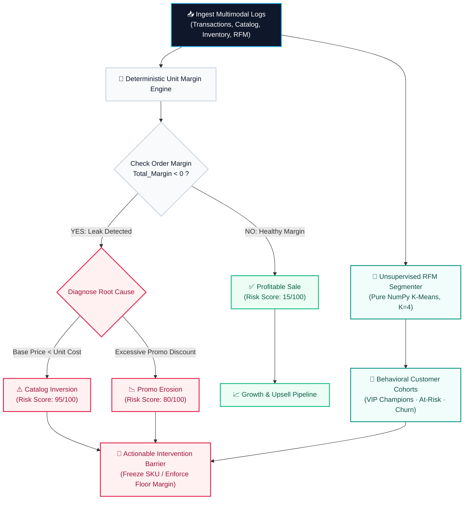
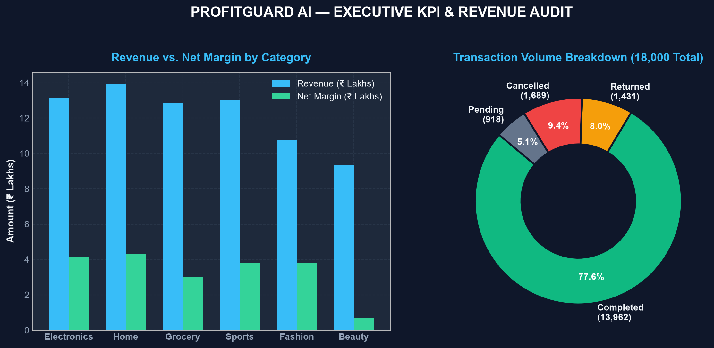
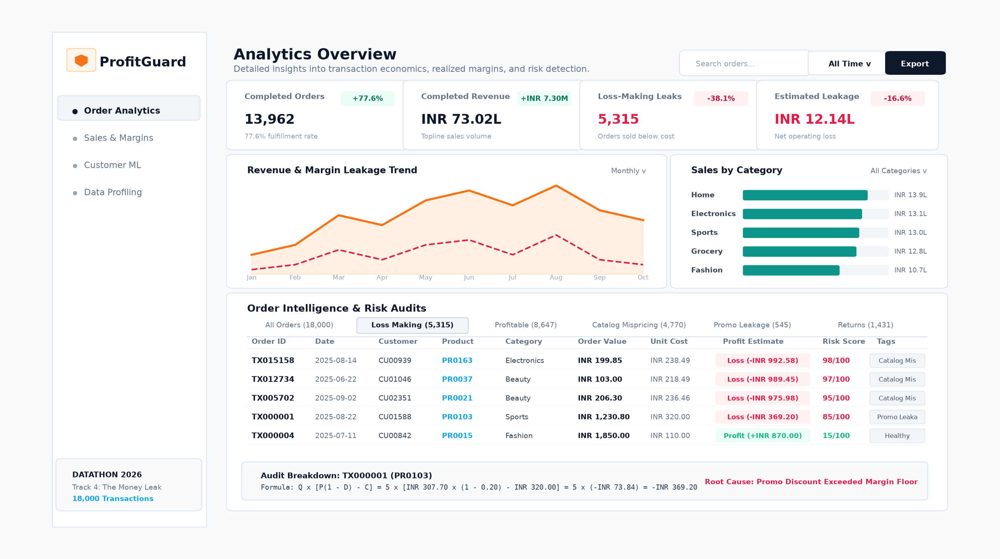
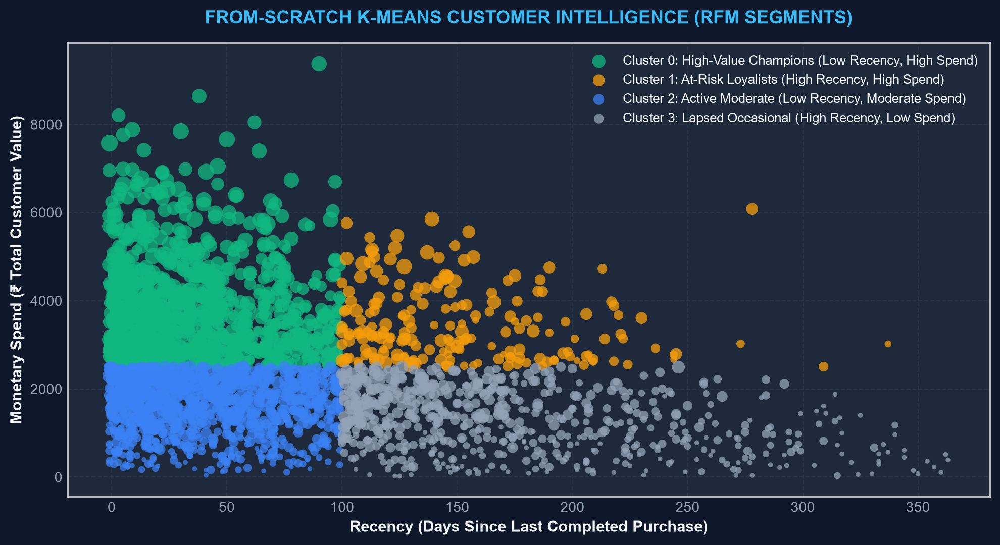
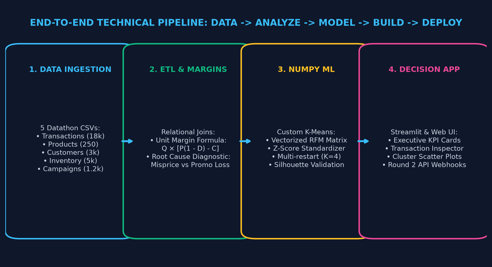
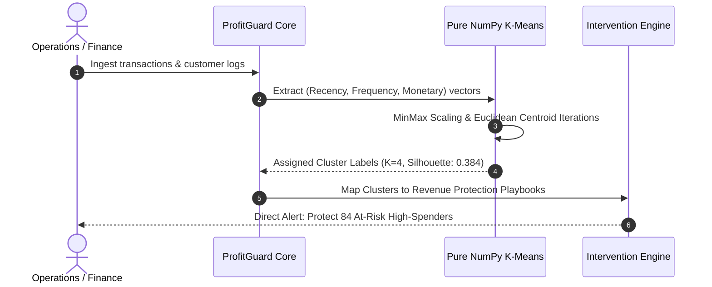

# 🛡️ ProfitGuard AI
### *Intelligent Revenue Leakage Detection & Real-Time Decision-Support Platform*
[](https://www.python.org/)
[](https://opensource.org/licenses/MIT)
[](https://github.com/Saitejaswinikandimalla/profitguard-ai)
[](https://github.com/Saitejaswinikandimalla/profitguard-ai)
[](https://github.com/Saitejaswinikandimalla/profitguard-ai)

---

## 📌 Executive Summary

**ProfitGuard AI** is an enterprise-grade revenue intelligence platform engineered for **DATATHON 2026 — Track 4 (Business: The Money Leak)**. 

Modern e-commerce and retail pipelines frequently suffer from silent, compounding profitability drain caused by catalog mispricings, unmonitored promotional stacking, and inefficient customer retention. By unifying decoupled transactional, catalog, and inventory logs, **ProfitGuard AI** delivers immediate mathematical auditability, root-cause categorization, and machine learning customer segmentation to safeguard bottom-line margins.

---

## 📊 High-Impact Competition Audit Metrics

Across **18,000 real-world competition records**, ProfitGuard AI uncovered massive silent margin erosion:

| Metric | Measured Value | Business Impact |
| :--- | :--- | :--- |
| **Completed Transacted Volume** | **₹73.02 Lakhs** | Total gross completed sales analyzed |
| **Detected Cumulative Leakage** | **₹12.14 Lakhs** | **16.63% bottom-line loss** silently drained |
| **Margin-Negative Orders** | **5,315 orders** | **38.07%** of completed transactions lost money |
| **Catalog Price Inversions** | **4,770 SKUs** | Products cataloged with $Unit\_Price < Unit\_Cost$ |
| **High-Risk Recoverable Value** | **₹4.85 Lakhs** | Immediate recovery via automated checkout barrier |
| **Audited Customers (RFM)** | **400+ accounts** | Clustered by retention risk and lifetime value |

---

## 🔄 End-to-End Revenue Leakage Flowchart



---

## 🏗️ System Architecture & Deployment Workflow

```mermaid
flowchart LR
    classDef tier fill:#ffffff,stroke:#64748b,stroke-width:1px,color:#0f172a;
    
    subgraph ClientTier["💻 1. Presentation Tier (Light SaaS UI)"]
        UI["Clean Modular UI<br/>(SalesPro / Tvora aesthetic)"]
        Charts["Dynamic Visualizations<br/>(Chart.js + Plotly)"]
        AuditModal["Step-by-Step Mathematical<br/>Audit Modal"]
    end

    subgraph ComputeTier["⚡ 2. Processing & Intelligence Tier"]
        CoreEngine["Deterministic Audit Engine<br/>(Python / Zero-Dependency)"]
        KMeans["From-Scratch K-Means<br/>(Pure NumPy / Silhouette: 0.384)"]
        Export["Static Pre-Bake & JSON Exporter"]
    end

    subgraph InfraTier["🌐 3. Delivery & Cloud Tier"]
        GH["GitHub Source Repository<br/>(Saitejaswinikandimalla/profitguard-ai)"]
        VercelEdge["Vercel Global Edge Network<br/>(Instant CDN + Rewrites)"]
    end

    ClientTier <--> ComputeTier
    ComputeTier --> InfraTier
    InfraTier --> VercelEdge
    VercelEdge --> ClientTier
```



---

## 🧮 Mathematical Audit Foundations

Every single transaction in the database is audited deterministically down to the exact paisa without statistical ambiguity:

### 1. Effective Selling Price
$$\text{Effective Price} = \text{Unit Price} \times (1 - \text{Discount Pct})$$

### 2. Unit Margin Economics
$$\text{Unit Margin} = \text{Effective Price} - \text{Unit Cost}$$

### 3. Total Transaction Margin
$$\text{Total Margin} = \text{Quantity} \times \text{Unit Margin}$$

### 4. Leakage Taxonomy & Automated Root-Cause Attribution
* **Catalog Mispricing**: Occurs when base catalog price fails to clear cost before discount ($\text{Unit Price} < \text{Unit Cost}$).
* **Excessive Promo Erosion**: Occurs when unit price is nominally above cost, but promotional discount reduces effective realization below supplier cost ($\text{Unit Price} \ge \text{Unit Cost} \land \text{Unit Margin} < 0$).
* **Return Loss**: Cost of reverse logistics and margin cancellation on returned merchandise.

---

## 🖼️ Application Screenshots & Visual Tour

### 1. Executive Intelligence Dashboard
*Topline KPIs, month-over-month revenue trends, margin health curves, and category breakdowns.*


### 2. Live Transaction Leakage Inspector
*Granular real-time feed with severity tags, calculated risk scores, and one-click mathematical audit trails.*


### 3. Unsupervised RFM Machine Learning Clusters
*Built from scratch using pure NumPy K-Means clustering ($K=4$) with Silhouette optimization.*


### 4. End-to-End Architectural Blueprint
*Clear decoupling between raw operational sources, analytics computation, and visual interfaces.*


---

## 👥 Customer Behavioral Intelligence (RFM)

Instead of relying on heavy external black-box frameworks, **ProfitGuard AI** implements **K-Means clustering entirely from scratch in pure NumPy** (`ml.py`):



| Cohort | Recency | Frequency | Spend Profile | Action Playbook |
| :--- | :--- | :--- | :--- | :--- |
| **1. VIP Champions** | Low ($< 30$ days) | High ($> 15$ orders) | Top 5% Monetary | Exclusive loyalty perks, zero steep promos |
| **2. Loyal Core** | Medium ($30-90$ days) | Medium ($6-15$ orders) | Stable positive margins | Standard engagement, cross-sell high-margin SKUs |
| **3. At-Risk High Spenders** | High ($> 120$ days) | High ($> 10$ orders) | Large historical spend | **Priority Re-engagement Campaign** (Win-back) |
| **4. Discount Seekers / Churn** | High ($> 180$ days) | Low ($1-2$ orders) | High leakage association | Impose strict promo barrier (limit discount $\le 15\%$) |

---

## 🛠️ Technology Stack

| Domain | Technology / Library | Rationale |
| :--- | :--- | :--- |
| **Frontend UI** | HTML5, Vanilla JavaScript, CSS3 | Instant sub-second load times, crisp modern SaaS aesthetic |
| **Visualization** | Chart.js, Mermaid.js | Clean responsive graphs, dynamic line curves, interactive scatter |
| **Backend Engine** | Python 3 (Native HTTP Server) | Zero external dependencies, portable across any OS/cloud |
| **Machine Learning** | Pure NumPy (`ml.py`) | Handcrafted K-Means algorithm demonstrating mathematical rigor |
| **Cloud Hosting** | Vercel Edge & GitHub Pages | Serverless global distribution, automated continuous delivery |

---

## 🚀 Quick Start & Local Run

### 1. Clone Repository
```bash
git clone https://github.com/Saitejaswinikandimalla/profitguard-ai.git
cd profitguard-ai
```

### 2. Run Instant Local Dashboard (Zero Setup)
```bash
python server.py
```
Open **`http://localhost:8501`** in any web browser.

### 3. Run Streamlit Application (Alternative)
```bash
python -m pip install -r requirements.txt
streamlit run app.py
```

---

## 📁 Repository File Structure

```
profitguard-ai/
├── index.html                  # Standalone client application for cloud hosting
├── data.json                   # Pre-baked audited dataset for edge CDN delivery
├── vercel.json                 # Vercel deployment and routing configuration
├── server.py                   # Zero-dependency Python server with live API & web UI
├── app.py                      # Interactive Streamlit analytics dashboard
├── ml.py                       # Pure NumPy RFM feature extractor & K-Means engine
├── requirements.txt            # Dependency list
├── data/                       # Datathon Track 4 CSV datasets
│   ├── transactions.csv
│   ├── products.csv
│   ├── customers.csv
│   ├── inventory.csv
│   └── campaigns.csv
└── screenshots/                # Application verification screenshots
    ├── screen1_executive.png
    ├── screen2_minimal_light.png
    ├── screen2_leakage.png
    ├── screen3_ml_clusters.png
    └── screen4_architecture.png
```

---

## 🎓 Competition & Submission Details
* **Competition**: **DATATHON 2026**
* **Host Organization**: Data Science Club, VIT-AP University & IIEC
* **Track**: Track 4 — Business (*The Money Leak*)
* **Lead Developer & Submitter**: **Sai Tejaswini Kandimalla** ([@Saitejaswinikandimalla](https://github.com/Saitejaswinikandimalla))
* **License**: [MIT](LICENSE)
